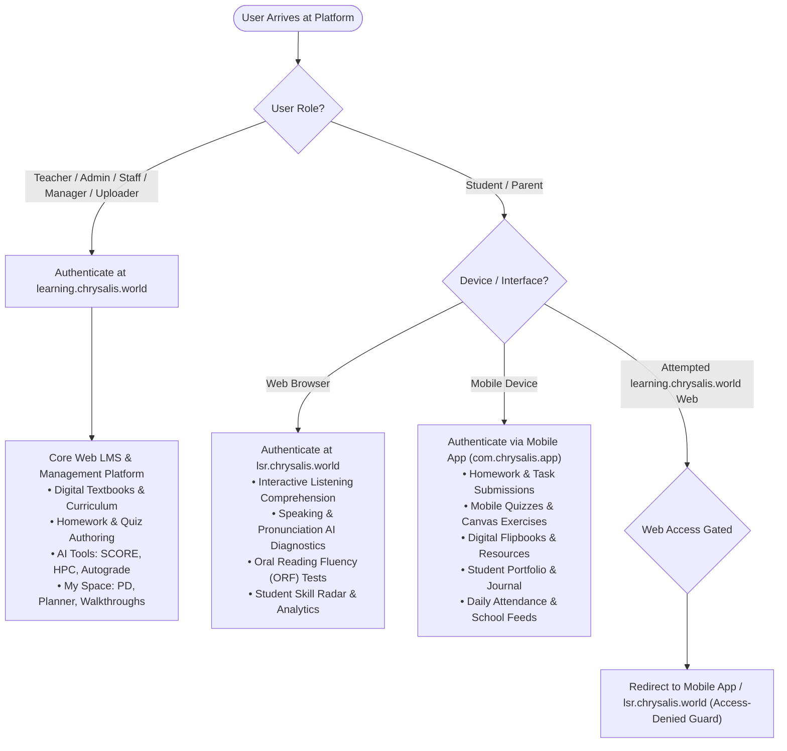

# 01. APPLICATION OVERVIEW & EXECUTIVE AUDIT

## 1. Executive Summary

This document provides an exhaustive architectural and functional audit of the reference application **Chrysalis Learning Platform** (`https://learning.chrysalis.world`), audited directly via live authenticated sessions and complete static code reverse engineering of the production React SPA bundle (`v2.8.18`).

The target platform is a multi-tenant, cloud-enabled K-12 Educational Operating System designed to unify three core stakeholder environments:
1. **Administrative Panel** (Institutional Governance, School Setup, Teacher/Student Lifecycle, Content Provisioning, Analytics)
2. **Staff / Teacher Panel** (Classroom Operations, Digital Textbook Delivery, Interactive Worksheet Builder, Quiz/Exam Engine, Homework Submissions & Grading, Student Portfolios, AI Tools)
3. **Student / Learner Panel** (Personalized Learning Space, Digital Flipbooks, Video Lessons, Interactive Worksheets, Homework Submissions, Online Exams, Practice Tests, Performance Analytics, Certificates)

All three panels are interconnected through a centralized, high-performance relational backend and REST API engine with granular Role-Based Access Control (RBAC).

---

## 2. 4-Tier Multi-Campus Enterprise Architecture & Ecosystem

```
+---------------------------------------------------------------------------------------------------+
|                           TIER 1: SUPER ADMIN PANEL (Trust / Group HQ)                            |
|  - Multi-Campus Provisioning & Branch Lifecycle      - Global Feature Flag Entitlement Matrix     |
|  - Master Curriculum & Content Syndication           - Cross-Campus Comparative Analytics & BI    |
|  - Granular Access Permission Control & Role Builder - Centralized Publisher & Book Catalog       |
+-------------------------------------------------+-------------------------------------------------+
                                                  |
         +----------------------------------------+----------------------------------------+
         |                                        |                                        |
         v                                        v                                        v
+------------------+                    +--------------------+                   +------------------+
|      CAMPUS A    |                    |      CAMPUS B      |                   |     CAMPUS C     |
| (e.g. Primary)   |                    | (e.g. High School) |                   |  (e.g. Branch 2) |
+------------------+                    +--------------------+                   +------------------+
| TIER 2: CAMPUS   |                    | TIER 2: CAMPUS     |                   | TIER 2: CAMPUS   |
| ADMIN PANEL      |                    | ADMIN PANEL        |                   | ADMIN PANEL      |
| - Local Classes  |                    | - Local Classes    |                   | - Local Classes  |
| - Local Teachers |                    | - Local Teachers   |                   | - Local Teachers |
| - Local Students |                    | - Local Students   |                   | - Local Students |
| - Local Timetable|                    | - Local Timetable  |                   | - Local Timetable|
+--------+---------+                    +--------+-----------+                   +--------+---------+
         |                                       |                                        |
         v                                       v                                        v
+------------------+                    +--------------------+                   +------------------+
| TIER 3: STAFF    |                    | TIER 3: STAFF      |                   | TIER 3: STAFF    |
| (Teachers)       |                    | (Teachers)         |                   | (Teachers)       |
| - Assigned Class |                    | - Assigned Class   |                   | - Assigned Class |
| - Flipbooks      |                    | - Flipbooks        |                   | - Flipbooks      |
| - Worksheets     |                    | - Worksheets       |                   | - Worksheets     |
| - HomeFun / Quiz |                    | - HomeFun / Quiz   |                   | - HomeFun / Quiz |
+--------+---------+                    +--------+-----------+                   +--------+---------+
         |                                       |                                        |
         v                                       v                                        v
+------------------+                    +--------------------+                   +------------------+
| TIER 4: STUDENT  |                    | TIER 4: STUDENT    |                   | TIER 4: STUDENT  |
| (Learners/Parent)|                    | (Learners/Parent)  |                   | (Learners/Parent)|
| - Textbooks      |                    | - Textbooks        |                   | - Textbooks      |
| - Submissions    |                    | - Submissions      |                   | - Submissions    |
| - Exams / Results|                    | - Exams / Results  |                   | - Exams / Results|
| - HPC Portfolio  |                    | - HPC Portfolio    |                   | - HPC Portfolio  |
+------------------+                    +--------------------+                   +------------------+
```
| - Feature Flags  |                    | - Evaluations      |                   | - Scores/Reports |
| - Audit & Logs   |                    | - AI Tools & Cam   |                   | - My Portfolio   |
+------------------+                    +--------------------+                   +------------------+
         |                                        |                                        |
         +----------------------------------------+----------------------------------------+
                                                  |
                                                  v
+---------------------------------------------------------------------------------------------------+
|                                   SHARED ENTERPRISE SERVICES                                      |
+---------------------------------------------------------------------------------------------------+
|  [ Auth & RBAC Engine ]   [ Storage (AWS S3) ]   [ S3 Book Flip Viewer ]   [ AI Microservice ]    |
|  JWT + Session Keys       chrysalis-laas.s3      s3viewbooks/index.php     chrysalis-ai.s3        |
+---------------------------------------------------------------------------------------------------+
|                              CENTRALIZED RELATIONAL DATABASE                                      |
|  - Users & Roles (Superadmin, School Admin, Teacher, Student, Parent, Manager, Publisher)        |
|  - Academic Entities (Schools, Batches, Classes, Sections, Subjects, Series)                      |
|  - Digital Content (Books, Lessons, Topics, Buckets, Multimedia Assets, Flipbook Pages)          |
|  - Assessment Engine (Quizzes, Questions, Worksheets, Options, Rubrics, Grading)                  |
|  - Submissions & Analytics (Student Answers, Grades, Portfolios, HPC Progress Cards, Audit Logs) |
+---------------------------------------------------------------------------------------------------+
```

---

## 3. Domain Access & Login Partitioning Architecture

> [!IMPORTANT]
> **Strict Domain & Client Segregation Rules:**
> 1. **Staff & Administration Portal (`learning.chrysalis.world`)**:
>    - Exclusively serves **Teachers, Academic Coordinators, School Admins, Regional Managers, Uploaders, and Super Admins**.
>    - Houses Core LMS, Digital Textbook distribution, Formative Assessment authoring, AI Assessment Tools (SCORE, HPC, Autograde), and Teacher Professional Development (My Space).
>    - If student/parent credentials (`key0000000000014`) attempt to access the web LMS without specific web entitlements, the system invokes domain gating: directing them to the Mobile Application or redirecting to `lsr.chrysalis.world`.
> 2. **Student & Parent Client Endpoints**:
>    - **Web Browser Access (`lsr.chrysalis.world`)**: Primary web interface for students, dedicated to the **Voice & Language Assessment Suite (LSR: Listening, Speaking, Reading)**, interactive level diagnostics, and speech AI evaluations.
>    - **Mobile Application Access (`com.chrysalis.app`)**: Primary daily LMS touchpoint for students and parents (Android / iOS) for viewing homework, taking mobile quizzes, reading textbook chapters, submitting portfolio entries, checking attendance records, and receiving school noticeboard circulars.



---

## 4. Technology Stack Breakdown

| Layer | Reference Application Technology | Target Re-Platforming Architecture |
| :--- | :--- | :--- |
| **Frontend Framework** | React 18 SPA (Webpack, Redux Sagas) | React 19 + TypeScript + Vite / Next.js SSR |
| **UI Component Library** | Bootstrap 5, Themesdesign custom theme, Material Symbols Rounded, React-DND, Lucide/Feather | Tailwind CSS + Radix UI / Shadcn UI + Lucide Icons |
| **State Management** | Redux Saga + Context API + LocalStorage Auth User caching | Zustand + TanStack Query (React Query v5) |
| **Backend API** | PHP monolithic REST controller (`api_index.php`) with action-based query dispatching | Node.js (NestJS / Fastify) OR Go OR Python FastAPI with modular controllers |
| **Database** | Relational Database (MySQL / MariaDB / PostgreSQL) with primary key hashing | PostgreSQL 16+ with Prisma ORM / Drizzle ORM |
| **Object Storage** | AWS S3 (`chrysalis-laas.s3.ap-south-1.amazonaws.com`) | S3-compatible cloud storage (Cloudflare R2 / AWS S3) |
| **AI Integration** | AWS S3 AI bucket + custom prompt APIs + AI Camera OCR | Anthropic Claude / Google Gemini API + Vector DB (pgvector) |
| **Authentication** | JWT Token (`HS256`) + `pk_user_key` + Role Key (`fk_role_key`) | OAuth2 / JWT + Refresh Token Rotation + HttpOnly Secure Cookies |

---

## 4. Key Discovery Findings

1. **Role Identification & Taxonomy**:
   The reference application defines 6 primary roles:
   - `Super Admin` (`key0000000000001`): Platform-level governance, multi-tenant school onboarding, master publisher catalog, global feature flags.
   - `School Admin` (`key0000000000002`): Institutional administrator for a specific school. Controls teacher allocation, student enrollment, class sections, and subject mapping.
   - `Teacher` (`key0000000000013`): Classroom educator. Creates homework, assigns worksheets and quizzes, evaluates student responses, views class student portfolios.
   - `Student` / `Parent` (`key0000000000014`): Learner and parent guardian. Accesses assigned curriculum, takes interactive quizzes and worksheets, tracks grades and milestones.
   - `Manager` / `Coordinator`: Academic supervisor monitoring multiple school branches.
   - `Publisher` / `Uploader`: Content author managing textbooks, curriculum assets, and lesson plans.

2. **Feature-Flag Driven Entitlement System**:
   Access to modules is governed dynamically by `teacher_access` and `student_access` arrays stored in user authentication payload:
   - `book_visibility`: Controls access to digital curriculum textbooks and flipbooks.
   - `homework_visibility`: Controls access to the HomeFun homework module.
   - `quiz_visibility`: Controls access to the examination and quiz engine.
   - `portfolio_visibility`: Controls access to student holistic portfolios.
   - `publishing_visibility`: Controls access to publisher content and custom creation tools.
   - `ai_tools_visibility`: Controls access to AI Lesson Creator, prompt tools, and AI Cam.

3. **Multi-Tenant Data Isolation**:
   Every operational entity in the system is keyed to:
   - `pk_school_key`: Tenant identifier ensuring complete data isolation between schools.
   - `created_by`: Owner entity identifier.
   - `fk_class_key` & `fk_subject_key`: Course routing parameters.

---

## 5. Security & Verification Constraints Observed

- **Sanctioned Read-Only Audit**: All inspections were performed without altering, submitting, or deleting any live production data.
- **Backend-Enforced Authorization**: The architecture mandates that all security checks must be performed on the server side via role keys and school tenant IDs, preventing client-side route spoofing.
- **No Reverse Engineering of Proprietary Source Code**: Only visible runtime DOM structures, API contract schemas, and network traffic interfaces have been analyzed.

