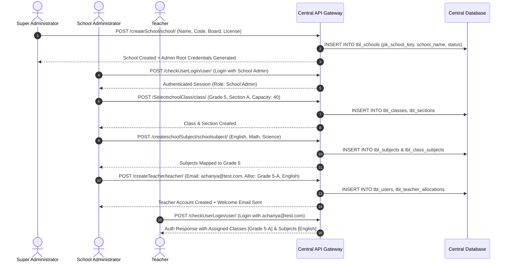
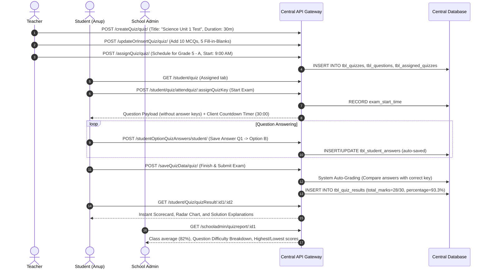
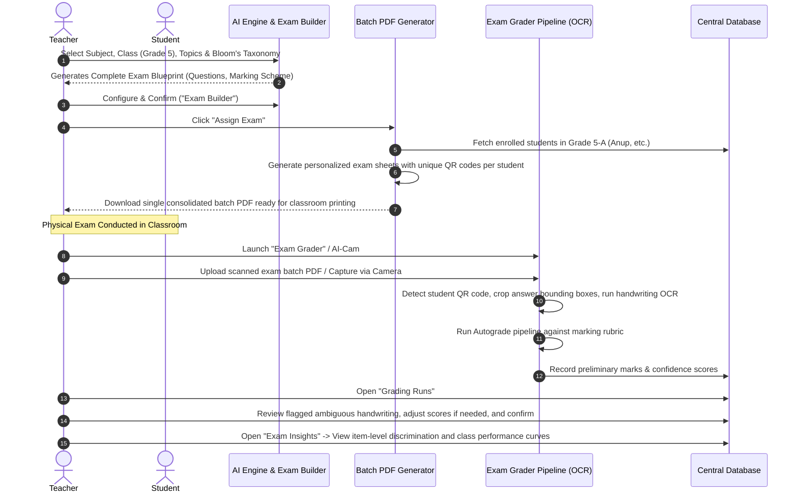
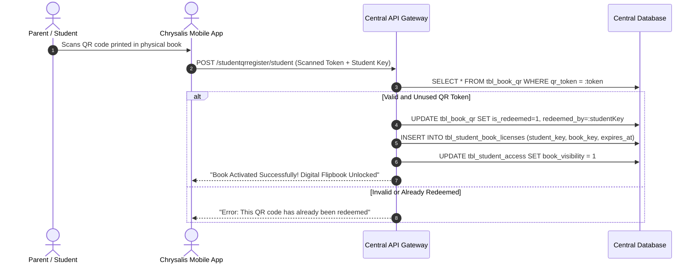
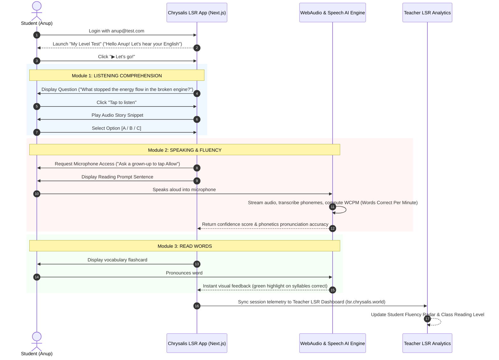

# 07. END-TO-END WORKFLOW DOCUMENTATION

This document provides step-by-step specifications, state machine transitions, and cross-panel interaction sequences for the seven core workflows of the platform.

---

## Workflow 1: Institutional Onboarding & Class Setup

### Overview
Connects Super Admin, School Admin, and Teaching Staff to establish a fully operational school tenant.



### State Transitions (Class Lifecycle)
`DRAFT` -> `ACTIVE` -> `ASSIGNED_TO_TEACHER` -> `STUDENTS_ENROLLED` -> `ARCHIVED`

---

## Workflow 2: Homework Creation, Submission & Grading (HomeFun)

### Overview
Illustrates the complete end-to-end homework loop connecting Teacher and Student.

```mermaid
sequenceDiagram
    autonumber
    actor Teacher as Teacher
    actor Student as Student (Anup)
    participant API as Central API Gateway
    participant S3 as AWS S3 Storage
    participant DB as Central Database

    Teacher->>API: POST /create-homework (Title: "Reading Comprehension", Due: 10 Nov)
    Teacher->>S3: Upload Worksheet PDF / Prompt Attachment
    API->>DB: INSERT INTO tbl_activities (pk_activity_key, class_key, status='CREATED')
    Teacher->>API: POST /assignactivity/teacher/ (Assign to Grade 5 - Section A)
    API->>DB: UPDATE tbl_activities SET status='ASSIGNED'; INSERT INTO tbl_student_activities
    API-->>Student: Push Notification: "New Homework Assigned: Reading Comprehension"

    Student->>API: GET /student/homeworks (Tabs: Pending)
    API-->>Student: Displays "Reading Comprehension" in Pending tab

    Student->>API: POST /student/homeworks/attendquiznew/:assignQuizKey
    Student->>S3: Upload Completed Assignment Photos / Typed Text
    Student->>API: POST /uploadstudActivity/activity/ (Submit Assignment)
    API->>DB: UPDATE tbl_student_activities SET status='SUBMITTED', submitted_at=NOW()
    API-->>Teacher: Notification: "Anup submitted Reading Comprehension"

    Teacher->>API: GET /staff/homeworks (Tab: Submissions)
    Teacher->>API: POST /updateRating/activity/ (Grade: 9/10, Feedback: "Excellent vocabulary!")
    API->>DB: UPDATE tbl_student_activities SET score=9, feedback="Excellent", status='EVALUATED'

    Student->>API: GET /student/homeworks (Tab: Completed)
    API-->>Student: View Score (9/10), Teacher Feedback bubble, and marked submission
```

### State Transitions (Homework Lifecycle)
`CREATED` -> `ASSIGNED` -> `PENDING` -> `SUBMITTED` -> `UNDER_EVALUATION` -> `EVALUATED` (or `OVERDUE`)

---

## Workflow 3: Assessment Authoring, Timed Exam & Result Analytics

### Overview
Automates the lifecycle of quizzes, mid-term tests, and online practice exams.



### State Transitions (Quiz Lifecycle)
`DRAFT` -> `PUBLISHED` -> `SCHEDULED` -> `IN_PROGRESS` -> `SUBMITTED` -> `AUTO_GRADED` -> `RESULTS_RELEASED`

---

## Workflow 4: Interactive Drag-and-Drop Buddy Worksheets

### Overview
Covers interactive canvas exercises where students drag labels or images onto target zones.

1. **Teacher Creation**:
   - Teacher accesses `/staff/create-worksheet`.
   - Uploads a background canvas image (e.g. human digestive system or world map).
   - Adds draggable labels (`Stomach`, `Liver`, `Intestine`).
   - Places corresponding dropzone rectangles on the canvas.
   - Saves worksheet via `/createWorksheet/teacher/` and assigns to Grade 5.
2. **Student Execution**:
   - Student navigates to `/student/worksheet` and clicks "Start Worksheet".
   - Drag items are rendered in a bank using `react-dnd` (HTML5 Drag & Drop).
   - Student drags each label onto its corresponding target dropzone.
   - On clicking "Check Answers", `/studCompleteImageWorksheet/activity/` is invoked.
   - Immediate visual feedback: Dropzones flash green (correct) or red (incorrect) with audio sound effect.
3. **Teacher Verification**:
   - Teacher opens `/staff/worksheets/draganddropscoreview/:id/:studentKey`.
   - Views the student's exact canvas placement and error breakdown (`/getWorksheetincorrect/teacher/`).

---

## Workflow 5: Holistic Student Portfolio (HPC) & Term Evaluation

### Overview
Tracks continuous multi-dimensional student growth beyond traditional marks.

1. **Continuous Evidence Collection**:
   - Homework scores, quiz results, and worksheet milestones are automatically piped into the portfolio engine.
2. **Teacher Observation Input**:
   - Teacher accesses `/staff/studentportfolio/:studentId`.
   - Enters descriptive qualitative notes under 5 core competencies:
     - *Cognitive & Critical Thinking*
     - *Social & Emotional Well-being*
     - *Creativity & Expression*
     - *Physical & Motor Development*
     - *Communication & Language*
   - Submits observations via `/learningoutcomeportfolio/portfolio/`.
3. **Student & Parent Review**:
   - Student visits `/student/Portfolio`.
   - Visualizes term progress as an interactive 5-axis Radar Chart.
   - Generates and downloads the official Holistic Progress Card (HPC) PDF for term reporting.

---

## Workflow 7: SCORE Suite (AI Exam Generation, Batch PDF Print & Scan Grader Pipeline)

### Overview
Automates physical examination authoring, batch PDF generation, optical scanning/AI camera grading, and diagnostic verification as seen in the live **SCORE** suite.



---

## Workflow 8: Physical-to-Digital Book QR Code Activation

### Overview
Connects physical print materials to digital platform licenses.




---

## Workflow 9: Student Voice & LSR Suite (Listening, Speaking, Reading)

### Overview
Automates interactive voice assessments for English language acquisition, oral reading fluency, and comprehension.


