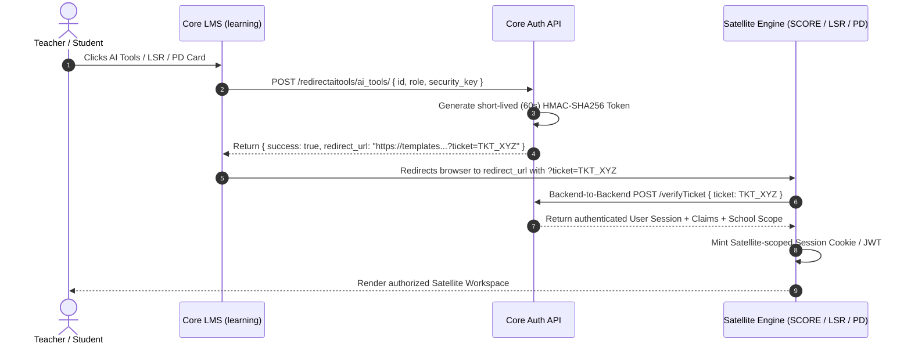
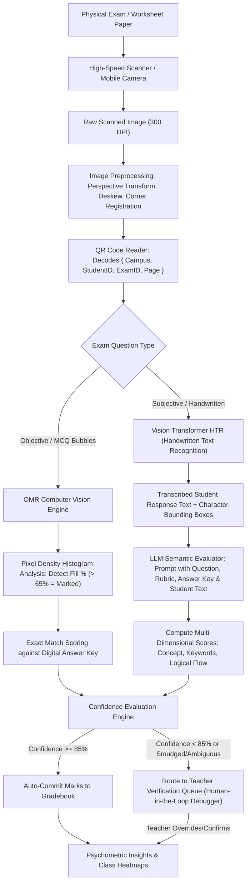
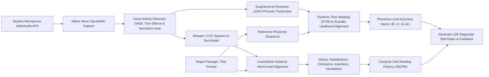
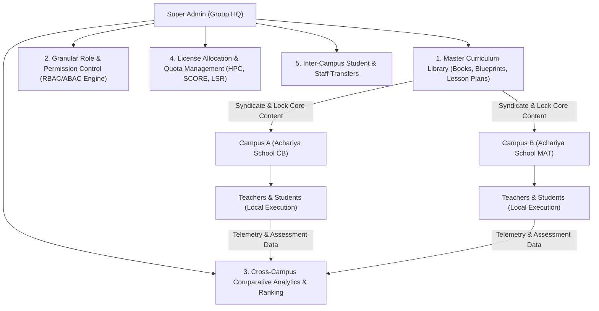

# Business Logic, Algorithmic Processes & AI Integration Specification

## 1. Executive Summary & Architectural Overview

The reference learning platform (`Chrysalis World`) is an enterprise-grade EdTech and Assessment ecosystem engineered across a federated multi-service architecture:
1. **Core LMS SPA (`learning.chrysalis.world`)**: Primary user hub for Authentication, Academic Delivery, Daily Operations, Formative Work, and Social Feeds.
2. **SCORE Assessment Suite (`templates.chrysalis.world`)**: Summative Exam Builder, Algorithmic Batch Exam Layout Generation, Optical Mark & Handwritten OCR Grader, and Psychometric Insights.
3. **VOICE / LSR Suite (`lsr.chrysalis.world`)**: Speech AI, Oral Reading Fluency (ORF), Acoustic Phoneme Alignment, and Audio Comprehension.
4. **My Space Suite (`pd.chrysalis.world` & `ppg.chrysalis.world`)**: Teacher Professional Development, Automated Pedagogical Planning, and Classroom Walkthrough Audits.

This specification details the computational algorithms, mathematical formulas, state machine lifecycles, validation rules, and Artificial Intelligence (LLM, Vision/HTR, Speech/ASR) pipelines embedded within every module across all four organizational tiers.

---

## 2. Cross-Cutting Core System Logics

### 2.1 Multi-Tenant Tenant Isolation & Security Logic
The platform operates on a hierarchical multi-tenant structure:
$$\text{Enterprise Trust (Super Admin)} \longrightarrow \text{Campus (School Admin)} \longrightarrow \text{Cohort (Staff / Teacher)} \longrightarrow \text{End Consumer (Student / Parent)}$$

- **Tenant Resolution Key**: `pk_school_key` (e.g., `0F2FF6E3FB2CF29D`).
- **Enforcement Principle**: Every database query in the application repository layer executes with an mandatory WHERE condition:
  $$\text{Query}(\text{Entity}) \equiv \sigma_{\text{school\_key} = \text{session.school\_key} \land \text{academic\_year} = \text{session.active\_year}}(\text{Entity})$$
  Only the **Super Admin** possesses a bypass token (`role_key = key0000000000001`) enabling cross-tenant aggregation and master curriculum syndication.

### 2.2 Feature License Gating Bitmask & Entitlements
Campus capabilities are governed by a dynamic feature flag object stored at the school entity level:
```json
{
  "basic": 1,
  "question_bank": 1,
  "hpc_license": 1,
  "auto_grade": 1,
  "prime_license": 1,
  "ai_tools": 1,
  "score": 1,
  "compass": 1,
  "voice": 1
}
```
**Access Resolution Formula**:
A user $U$ with role $R$ in school $S$ can access module $M$ if and only if:
$$\text{CanAccess}(U, S, M) \iff (S.\text{license}[M] == 1) \land (R.\text{permissions}[M] \in \{\text{READ}, \text{WRITE}, \text{ADMIN}\})$$

### 2.3 Cross-Domain SSO Ticket Exchange Protocol
When a user navigates from Core LMS to satellite domains (`templates`, `lsr`, `pd`, `ppg`), the client initiates an asymmetric ticket exchange:


---

## 3. Module-by-Module Logic & AI Integration Matrix

| Module Name | Core Computational Logic & Process | AI / ML Technology Stack | Exact Role of AI in Module |
| :--- | :--- | :--- | :--- |
| **01. Digital Books & Content Engine** | Single-use QR physical book redemption state machine; vector canvas SVG parsing; dynamic watermark rendering. | Computer Vision (Mobile QR Scanner) & Content Embedding Models | Scans printed textbook QR codes; semantic chapter search and concept-linking across curriculum. |
| **02. Homework Engine** | Submission state machine (Assigned $\to$ In-Progress $\to$ Submitted $\to$ Evaluated $\to$ Returned); attachment MIME/virus scanning; deadline lock. | LLM-based Evaluator & Feedback Generator | Analyzes submitted student essays/answers; checks conceptual alignment against rubrics; drafts personalized teacher feedback. |
| **03. Quiz Engine** | Real-time autosave timer; randomized question order permutation; exact/fuzzy scoring logic; instantaneous result compilation. | Generative LLM & Psychometric Item Generator | Auto-generates balanced question pools (MCQ, True/False, Fill-in-Blanks) from chapter text; calibrates Bloom's taxonomy difficulty. |
| **04. Interactive Worksheet Engine** | Coordinate-based drag-and-drop bounding box collision detection; SVG bezier curve drawing; multi-attempt state tracking. | Layout OCR & Auto-Parsing Engine | Converts static PDF worksheets into interactive HTML5 drag-and-drop canvas exercises automatically. |
| **05. Student Portfolio & Journal** | File metadata extraction; multi-year longitudinal media indexing; privacy permissions (Private $\to$ Class $\to$ Showcase). | Multimodal Vision-Language Model (VLM) | Auto-tags student drawings/projects; generates qualitative developmental summaries of artistic and expressive growth. |
| **06. Attendance & Anthropometrics** | Attendance percentage formula; BMI percentile calculation; low attendance alert triggers; CBSE Health Card compliance. | Predictive Time-Series & Anomaly Detection | Identifies chronic absenteeism patterns; predicts dropout/learning risk before quarter-end. |
| **07. Social Feed & Circulars** | Role-targeted broadcasting tree; push notification queuing; engagement analytics; content moderation. | NLP Sentiment & Safety Classifier | Auto-moderates parent comments/queries; flags toxic or inappropriate language; classifies circular urgency. |
| **08. Offline Exam Marks Entry** | Grade threshold normalization; CBSE 9-point grading scale; aggregate weighted percentage; pass/fail criteria. | Statistical Outlier & Discrepancy Detection | Flags scoring anomalies (e.g. marks entered exceeding max marks, unnatural standard deviation in section). |
| **09. Autograde (AI Response Grader)** | OCR transcription of student handwriting; semantic similarity scoring; rubric dimension matrix evaluation; confidence thresholding. | Fine-Tuned Handwriting OCR (HTR) + Transformer Semantic Evaluator (LLM) | Transcribes handwritten answers; grades against reference answer key; assigns partial credit; flags low-confidence (<85%) cases. |
| **10. Holistic Progress Card (HPC / COMPASS)** | 5-Domain NEP 2020 observation aggregation; rubric Likert scale weighting; radar chart normalized vector geometry. | Generative Synthesis LLM | Synthesizes hundreds of teacher micro-observations into coherent, strengths-based 360-degree narrative report cards. |
| **11. SCORE: Exam Builder** | Syllabus blueprint constraint satisfaction solver; mark allocation balance; multi-set anti-cheating scrambling. | Generative Reasoning LLM | Generates authentic exam questions, distractor options for MCQs, rubrics, and marking schemes mapped to syllabus outcomes. |
| **12. SCORE: Assign Exam & Batch PDF** | Algorithmic layout pagination; personalized watermarked 2D QR generation; registration anchor alignment printing. | Algorithmic Document Synthesis & Barcode Encoding | Encodes student roll, class, exam, and question boundary coordinates into fault-tolerant Reed-Solomon QR codes. |
| **13. SCORE: Exam Grader (OCR Pipeline)** | Perspective transform; deskewing; corner registration mark detection; bounding box slice extraction. | Optical Mark Recognition (OMR) + Vision Transformer OCR | Detects darkened MCQ bubbles; crops handwritten response regions; transcribes text; grades against digital rubric. |
| **14. SCORE: Exam Insights** | Classical Test Theory (CTT) & Item Response Theory (IRT); Question Difficulty ($p$); Discrimination Index ($D$). | Predictive Learning Analytics Engine | Identifies question bias, misleading distractors, class-wide concept misconceptions, and learning deficits. |
| **15. VOICE / LSR: Listening Module** | Audio streaming with play counter limitation ($\le 2$ plays); sequential comprehension question gating. | Neural Text-to-Speech (TTS) | Synthesizes clear, native-accented audio stories and comprehension dialogues tailored to student grade level. |
| **16. VOICE / LSR: Speaking & Pronunciation** | WebAudio MediaRecorder stream (16kHz mono); VAD (Voice Activity Detection); silence stripping. | Acoustic Speech-to-Phoneme Alignment Model (G2P + HMM/Transformer) | Aligns student spoken audio against reference phonemes; scores Pronunciation Accuracy, Fluency, and Intonation. |
| **17. VOICE / LSR: Reading (ORF)** | Words Correct Per Minute (WCPM) calculation; omission, substitution, insertion, and hesitation error categorizer. | Automated Speech Recognition (ASR) + Oral Reading Fluency Evaluator | Transcribes student reading aloud in real time; tracks word-by-word reading flow; computes Lexile/grade fluency levels. |
| **18. My Space: Professional Development** | Video progress tracking; quiz mastery checks; SCORM/xAPI event dispatching; certificate generation engine. | Adaptive Recommendation Model | Recommends targeted pedagogy training modules based on student assessment gaps identified in the teacher's classroom. |
| **19. My Space: Planner (PPG)** | Dynamic calendar scheduling algorithm; period-by-period curriculum pacing; holiday/exam gap compensation. | Automated Curriculum Pacing Optimizer | Adjusts teaching pace when unplanned closures occur, rebalancing remaining syllabus days before exams. |
| **20. My Space: Classroom Walkthrough** | Multi-factor observation rubric tally; longitudinal teaching trend analysis; coaching action item tracker. | NLP Observational Synthesizer | Analyzes observer notes across walkthrough visits; generates actionable formative coaching feedback for teachers. |

---

## 4. Deep Architectural Logic for Key AI Engines

### 4.1 Autograde & SCORE OCR Pipeline Logic



#### Detailed Formulas Used in SCORE Psychometrics:
1. **Item Difficulty Index ($p$-value)**:
   $$p = \frac{R}{N}$$
   Where $R$ is the number of correct responses and $N$ is the total number of students taking the test.
   - $p > 0.85$: Concept mastered / Question too easy.
   - $0.30 \le p \le 0.85$: Optimal psychometric discrimination.
   - $p < 0.30$: Concept deficit / Question overly difficult or flawed.

2. **Item Discrimination Index ($D$-score)**:
   $$D = \frac{R_{\text{Upper } 27\%} - R_{\text{Lower } 27\%}}{0.27 \times N}$$
   Measures whether high-performing students got the question right significantly more often than low-performing students. Questions with $D < 0.20$ are flagged for teacher review as potentially ambiguous.

---

### 4.2 VOICE / LSR Speech AI Pipeline Logic



#### Oral Reading Fluency (ORF) Mathematical Logic:
1. **Words Correct Per Minute (WCPM)**:
   $$\text{WCPM} = \frac{\text{Total Words Attempted} - (\text{Mispronunciations} + \text{Omissions} + \text{Substitutions})}{\text{Duration in Seconds}} \times 60$$
2. **Reading Accuracy Percentage ($A$)**:
   $$A = \left( \frac{\text{Words Correctly Read}}{\text{Total Words in Passage}} \right) \times 100$$
   - $A \ge 95\%$: Independent Reading Level.
   - $90\% \le A < 95\%$: Instructional Reading Level (Optimal learning zone).
   - $A < 90\%$: Frustration Reading Level (Requires scaffolded intervention).

---

### 4.3 Holistic Progress Card (HPC / COMPASS) AI Synthesis Logic

Under NEP 2020 guidelines, student progress cannot be evaluated solely through summative test marks. The HPC engine collects observational ratings across **5 Developmental Domains**:
1. **Cognitive Domain** (Inquiry, Critical Thinking, Mathematical Reasoning)
2. **Socio-Emotional Domain** (Empathy, Collaboration, Emotional Regulation)
3. **Physical & Motor Domain** (Gross/Fine Motor, Hygiene, Sportsmanship)
4. **Cultural & Aesthetic Domain** (Artistic Expression, Music, Creative Exploration)
5. **Ethical & Civic Domain** (Integrity, Environmental Consciousness, Respect)

#### Algorithmic Evaluation & Radar Chart Vector Geometry:
For each domain $d \in \{1, \dots, 5\}$, multiple observable descriptors $k$ are rated on a 4-level rubric:
$$\text{Level}(k) \in \{1: \text{Beginning}, 2: \text{Progressing}, 3: \text{Proficient}, 4: \text{Exemplary}\}$$
The normalized domain score $\bar{S}_d$ is calculated as:
$$\bar{S}_d = \frac{1}{|K_d|} \sum_{k=1}^{|K_d|} \frac{\text{Level}(k)}{4} \times 100$$
This generates a 5-dimensional coordinate vector $\mathbf{v} = (\bar{S}_1, \bar{S}_2, \bar{S}_3, \bar{S}_4, \bar{S}_5)$ plotted as an interactive SVG radar polygon.

#### LLM Prompting & Report Generation Pipeline:
To prevent teacher burnout while maintaining high pedagogical depth, an LLM synthesis agent processes the vector $\mathbf{v}$, alongside anecdotal notes and attendance records:
```text
SYSTEM: You are a child development psychologist and NEP 2020 pedagogical specialist.
INPUT: 
  - Student: Anup Sharma (Grade 5, Section A)
  - Radar Vector: Cognitive: 88%, Socio-Emotional: 92%, Physical: 75%, Aesthetic: 95%, Ethical: 90%
  - Teacher Anecdotes: "Passionate about group science experiments; sometimes rushes through handwriting."
TASK:
  - Generate a 3-paragraph strengths-based narrative covering:
    1. Key intellectual and creative milestones achieved this term.
    2. Social dynamics and peer collaboration strengths.
    3. Actionable, growth-mindset home recommendations for parents.
  - Tone: Encouraging, non-judgmental, constructive. Avoid raw numerical marks.
```

---

## 5. Super Admin Multi-Campus Centralized Governance Logic

In a multi-campus educational trust (such as Achariya Group with multiple campuses across Pondicherry and Tamil Nadu), the Super Admin module implements crucial business processes:



### Key Super Admin Business Logics:
1. **Master Curriculum Syndication**:
   - Group HQ creates a centralized Master Course and Exam Blueprint.
   - When syndicated to campuses, individual campuses can add local worksheets or supplementary notes, but the master textbook core and board-mandated summative exam dates remain immutable.
2. **Cross-Campus Comparative Benchmark**:
   - Calculates normalized score distributions across all campuses using standard Z-scores:
     $$Z = \frac{X - \mu}{\sigma}$$
   - Enables Group Academic Directors to identify schools needing teacher coaching or pedagogical support.
3. **Inter-Campus Student Migration State Machine**:
   - When a student moves from Campus 1 to Campus 2, their unique universal student identifier (`universal_student_id`) persists.
   - Academic history, historical attendance, and past Holistic Progress Cards transfer seamlessly while creating a clean enrollment snapshot in the new campus database shard.

---

## 6. Implementation Readiness & Transition Plan

All computational rules, validation routines, math formulas, and AI prompt contracts documented herein map directly to the database schema and service controllers to be constructed in **Phase 1 (Backend & Database Architecture)**.

